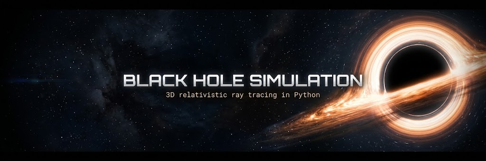
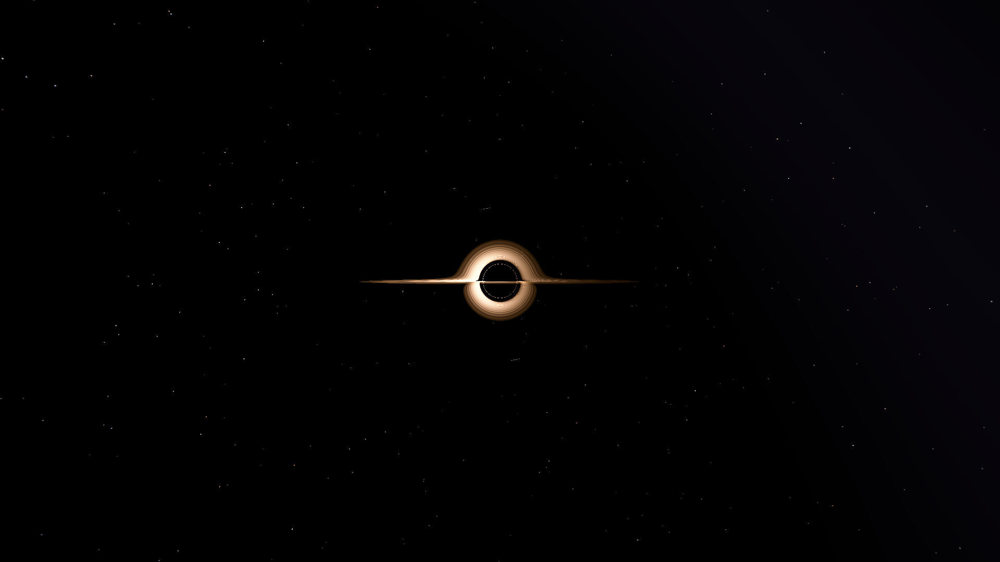
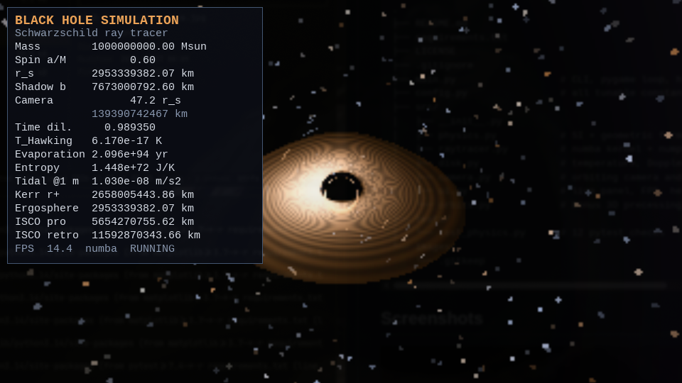

# Black Hole Simulation

A university project: a real-time 3D Schwarzschild black-hole visualiser with relativistic backward ray tracing, gravitational lensing, a thin Keplerian accretion disk, Doppler beaming, gravitational redshift and a live astrophysics panel. Pure Python + NumPy, JIT-compiled with Numba, presented with Pygame and exportable to full-HD PNG with Pillow. No audio, no sound libraries.


## About the Project

The renderer launches one ray per pixel from an orbiting camera and integrates the null geodesic backwards in time. Rays that fall through the Schwarzschild horizon are black; rays that cross the equatorial plane sample a thin accretion disk; escaping rays are looked up in a seeded procedural starfield. Because the integration is performed in the curved spacetime rather than in flat space, the shadow, the Einstein ring, the secondary disk image and the characteristic "halo" above and below the black hole emerge automatically.

The physics core uses geometrised units, `G = c = M = 1`, so the Schwarzschild radius is `rs = 2`. SI constants are used only for the live information panel. The camera distance, disk radii and other geometric controls are expressed in units of `rs`. A mass change therefore changes the physical labels (kilometres, kelvin, years) while leaving the scale-free Schwarzschild image unchanged. This is intentional and is stated in the code.

The Kerr spin parameter is included as an analytic diagnostic: `r+`, the equatorial ergosphere and the prograde/retrograde ISCO are computed exactly and shown in the panel. The ray tracer itself stays Schwarzschild because the required Cartesian null-geodesic form is spherically symmetric; full Kerr geodesics are listed in the roadmap.

## Features

- Real-time preview at `320x180` (configurable), upscaled with smooth filtering.
- Numba JIT backend over pixels, with an automatic pure-NumPy fallback.
- Adaptive RK4 integration of the Cartesian null-geodesic equation.
- Schwarzschild shadow, photon sphere, Einstein ring and lensed starfield.
- Thin equatorial disk from the ISCO (`3 rs`) to `20 rs`.
- Shakura-Sunyaev-like temperature profile and blackbody RGB colours.
- Keplerian rotation, Doppler beaming, gravitational redshift, `I_obs ∝ g^4`.
- Multiple disk crossings per ray: primary, secondary and higher-order images.
- Live panel: mass, spin, `rs`, shadow `b`, camera distance, time dilation,
  Hawking temperature, evaporation time, Bekenstein-Hawking entropy, horizon tides,
  Kerr `r+`, equatorial ergosphere, prograde/retrograde ISCO.
- Orbiting 3D camera with mouse drag, wheel zoom and keyboard inclination.
- Pause the disk, adjust mass and spin, toggle help, save a `1920x1080` PNG.
- Optional `src/orbits.py`: 3D relativistic test-star orbit with numerically
  integrated perihelion precession and a Matplotlib diagnostic plot.
- Deterministic seeded starfield and procedural disk texture.
- No audio code and no sound libraries.

## Physics

The internal unit system is `G = c = M = 1`; the Schwarzschild radius is `rs = 2`. Distances shown in the UI are converted to SI with the selected mass.

Schwarzschild radius, photon sphere, ISCO and shadow critical impact parameter:

$$
r_s = \frac{2GM}{c^2}, \qquad
r_{\rm ph} = \frac{3GM}{c^2} = 1.5\,r_s, \qquad
r_{\rm ISCO} = \frac{6GM}{c^2} = 3\,r_s,
$$

$$
b_c = 3\sqrt{3}\,\frac{GM}{c^2} = \frac{3\sqrt{3}}{2}\,r_s.
$$

The ray tracer integrates the Cartesian form of the null-geodesic equation, with the conserved specific angular momentum `h`:

$$
\frac{d^2\mathbf{x}}{d\lambda^2}
= -\frac{3}{2}\,r_s\,h^2\,\frac{\mathbf{x}}{|\mathbf{x}|^5},
\qquad
h = |\mathbf{x}\times\mathbf{v}|.
$$

The integration uses RK4 with an adaptive affine step, `dlambda ~ 0.02 r`, clamped for stability. A ray is absorbed when `r <= rs`.

Disk temperature profile (zero at the inner edge, peak near `1.36 r_in`):

$$
T(r) \propto r^{-3/4}
\left(1-\sqrt{\frac{r_{\rm in}}{r}}\right)^{1/4},
\qquad r_{\rm in}=3r_s,\quad r_{\rm out}=20r_s.
$$

The radial dependence is physical; the absolute colour scale `T_peak = 5200 K` is a visual choice so that a stellar-mass disk displays an orange-white palette instead of peaking in the invisible X-ray band.

Keplerian angular velocity and orbital speed:

$$
\Omega(r) = \sqrt{\frac{GM}{r^3}}, \qquad
v_\phi(r) = \sqrt{\frac{GM}{r}}.
$$

Doppler beaming plus gravitational redshift, and the observed blackbody quantities:

$$
g = \frac{\sqrt{1-r_s/r}}{\gamma\left(1-\mathbf{n}\cdot\boldsymbol{\beta}\right)},
\qquad
I_{\nu}^{\rm obs} = g^4 I_{\nu}^{\rm emit},
\qquad
T_{\rm obs} = g\,T_{\rm emit}.
$$

Here `n` points from the emitter toward the observer and `beta` is the Keplerian velocity vector divided by `c`. Disk colour is obtained from a Planckian-locus approximation; the bolometric intensity is multiplied by `g^4` and by the radial temperature profile.

Live thermodynamic and relativistic panel:

$$
T_H = \frac{\hbar c^3}{8\pi G M k_B}, \qquad
t_{\rm ev} = \frac{5120\,\pi\,G^2 M^3}{\hbar c^4},
$$

$$
S_{\rm BH} = \frac{k_B c^3 A}{4G\hbar}, \qquad
A = 4\pi r_s^2, \qquad
\Delta a_{\rm tide} = \frac{2GM\,\ell}{r_s^3},
$$

$$
\sqrt{1-\frac{r_s}{r}}\quad\text{(clock rate at the camera)}.
$$

Kerr diagnostics (analytic only):

$$
r_+ = M+\sqrt{M^2-a^2}, \qquad
r_{\rm ergo}(\theta=\pi/2)=2M,
$$

$$
Z_1 = 1+(1-a^2)^{1/3}\left[(1+a)^{1/3}+(1-a)^{1/3}\right], \qquad
Z_2 = \sqrt{3a^2+Z_1^2},
$$

$$
r_{\rm ISCO} = M\left[3+Z_2
\mp\sqrt{(3-Z_1)(3+Z_1+2Z_2)}\right],
$$

with the minus sign for prograde and the plus sign for retrograde orbits.

Bonus test-star precession, integrated from the Schwarzschild massive-particle equation in `u = 1/r`:

$$
\frac{d^2u}{d\varphi^2}+u = \frac{GM}{h^2}+\frac{3GM}{c^2}u^2,
\qquad
\Delta\varphi_{\rm weak} = \frac{6\pi GM}{c^2 a(1-e^2)}.
$$

## Installation

Python 3.10 or newer is required.

```bash
git clone https://github.com/QwFRx/blackhole-sim.git
cd blackhole-sim
python -m venv .venv
source .venv/bin/activate        # Windows: .venv\Scripts\activate
pip install -r requirements.txt
```

Numba is optional at runtime: if it is missing or fails to compile, the renderer automatically uses the vectorised NumPy backend. The NumPy fallback is slower, especially for full-HD stills.

## Usage

Interactive preview with the default `320x180` render surface (upscaled to a `960x540` window):

```bash
python main.py
```

Custom physical model and camera:

```bash
python main.py --width 480 --height 270 --mass 10 --spin 0.7 --distance 50 --inclination 20
```

Headless full-HD PNG export (`1920x1080` by default):

```bash
python main.py --render images/blackhole.png
```

You can override the still resolution; the camera and model flags are shared:

```bash
python main.py --render images/blackhole_4k.png --width 3840 --height 2160 \
  --mass 10 --spin 0.6 --distance 60 --inclination 18
```

Bonus relativistic orbit plot:

```bash
python -m src.orbits --output images/orbits.png
```

Run the test suite:

```bash
pytest -q
```

## Controls

| Input | Action |
| --- | --- |
| Mouse drag (left button) | Rotate camera azimuth / elevation |
| Mouse wheel | Zoom: change orbital distance |
| `Up` / `Down` | Increase / decrease inclination above the disk plane |
| `+` / `-` | Increase / decrease black-hole mass |
| `[` / `]` | Decrease / increase Kerr spin `a/M` in `[0, 0.99]` |
| `SPACE` | Pause / resume disk rotation |
| `P` | Save a `1920x1080` PNG to `images/` |
| `H` | Toggle the help overlay |
| `ESC` | Quit |

The FPS counter is shown in the information panel together with the active backend (`numba` or `numpy`) and the pause state. The camera distance is constrained to `8 ... 250 rs`; inclination to `1 ... 89` degrees above the disk plane.

## Project Structure

```text
.
├── README.md
├── requirements.txt
├── LICENSE
├── .gitignore
├── main.py                  # CLI, pygame loop, high-res export
├── config.py                # all tunable constants
├── src/
│   ├── __init__.py
│   ├── physics.py           # SI + geometric formulae, blackbody colours
│   ├── raytracer.py         # numba kernel + numpy fallback
│   ├── disk.py              # temperature, Doppler, texture, disk sampling
│   ├── camera.py            # orbiting camera and pixel rays
│   ├── ui.py                # live panel, FPS, help overlay
│   └── orbits.py            # bonus 3D precessing orbit + plot
├── tests/
│   └── test_physics.py      # 12 pytest checks
└── images/
    └── .gitkeep
```

## Screenshots





## Tests

`tests/test_physics.py` contains 12 checks:

- Solar Schwarzschild radius is approximately `2953 m`.
- Photon sphere is `1.5 rs`.
- Shadow critical impact parameter is `3√3 GM/c²` and approximately `7673 m` for the Sun.
- Solar Hawking temperature is approximately `6.17e-8 K`.
- Schwarzschild ISCO is `3 rs`.
- Zero-spin Kerr ISCO reduces to the Schwarzschild value.
- Prograde Kerr ISCO is smaller than retrograde.
- Kerr horizon is inside `rs`; equatorial ergosphere is exactly `rs`.
- Time dilation at `60 rs`.
- Evaporation time, entropy and horizon tides are finite and positive.
- Blackbody RGB ranges and cool/hot colour ordering.
- Aggregate system report consistency.

```bash
pytest -q
# 12 passed
```

## Roadmap

- Full Kerr geodesics with Boyer-Lindquist coordinates and frame dragging in the image.
- GPU backend (CUDA or WebGPU) for interactive full-HD rendering.
- Volumetric, optically thick disk with radiative transfer and spectral bands.
- Bloom, lens flare and physically based camera response.
- Video export and reproducible render scripts.
- Polarised light and Faraday rotation in the accretion flow.
- Time-dependent magnetohydrodynamic disk texture.
- Small web front-end sharing the same physics module.

## References

1. K. Schwarzschild, *Über das Gravitationsfeld eines Massenpunktes nach der Einsteinschen Theorie*, Sitzungsberichte der Königlich Preussischen Akademie der Wissenschaften (1916).
2. C. W. Misner, K. S. Thorne, J. A. Wheeler, *Gravitation*, W. H. Freeman (1973).
3. J.-P. Luminet, *Image of a spherical black hole with a thin accretion disk*, Astronomy & Astrophysics 75, 228-235 (1979).
4. O. James, E. von Tunzelmann, P. Franklin, K. Thorne, *Gravitational lensing by spinning black holes in astrophysics, and in the movie Interstellar*, Classical and Quantum Gravity 32, 065001 (2015); DNGR (Double Negative Gravitational Renderer) technical report.
5. J. M. Bardeen, W. H. Press, S. A. Teukolsky, *Rotating black holes: locally nonrotating frames, energy extraction, and scalar synchrotron radiation*, Astrophysical Journal 178, 347 (1972) — Kerr ISCO formula.

## License

Released under the MIT License. See [LICENSE](LICENSE).

## Author

**Deep Seekovich Flash** — university astrophysics / scientific computing project.

- GitHub: [@QwFRx](https://github.com/QwFRx)
- Email: `soon`

Replace the placeholder with your name, handle and contact before publishing.
